# Securing Linux SSH with Rublon MFA: A Step-by-Step Guide

📝 Originally published on [Medium](https://medium.com/@aabiodunadeleke/securing-linux-ssh-with-rublon-mfa-a-step-by-step-guide-6b7349fe8566) · 2024-09-21

---

Rublon MFA is a multi-factor authentication (MFA) solution designed to secure your organization’s data and control access to networks, servers, and applications. It supports a wide range of authentication methods, including Mobile Push, SMS Passcodes, QR Codes, WebAuthn/U2F Security Keys, and more.

In this guide, we will explore how to implement MFA for SSH on Linux using Rublon. MFA for Linux SSH adds an additional layer of security by requiring users to authenticate using multiple factors, such as passwords combined with secure authentication methods like Mobile Push or TOTP codes. Even if a password is compromised, MFA ensures that unauthorized access is prevented.

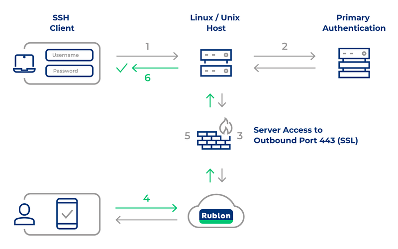

### Known Limitations

- If a user has enrolled multiple phones, only the MFA methods available on the default phone will be displayed in the SSH connector. There is no option to switch to another phone.
- After enrolling a phone number for SMS authentication or the Rublon Authenticator app, one authenticator may take priority over the other, potentially causing authentication methods for the other to be unavailable in the SSH interface.

### Step 1: Create an Application in the Rublon Admin Console

1. Sign up for the **Rublon Admin Console**. [Here’s how](https://admin.rublon.net/auth/login).

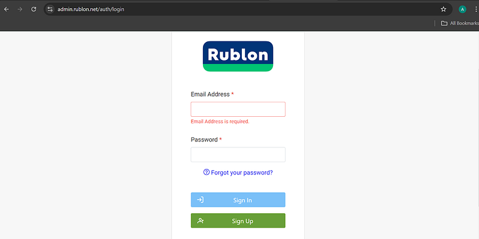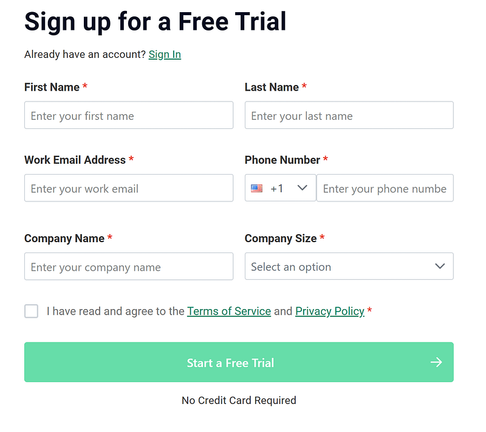

2. Activate **Rublon Authenticator**.

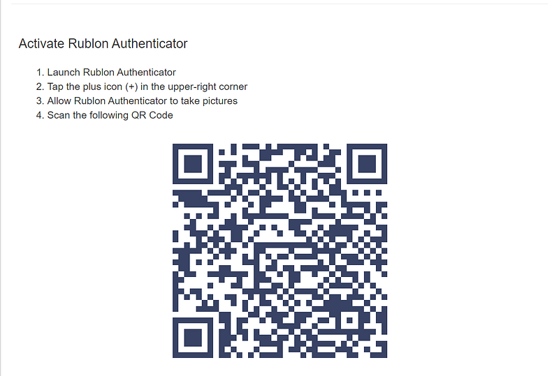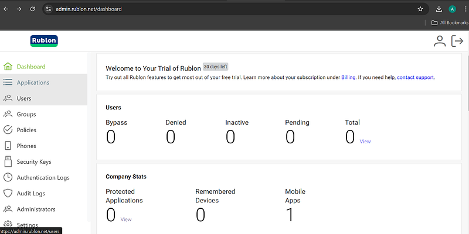

3. In the Admin Console, go to the **Applications** tab and click **Add Application**.

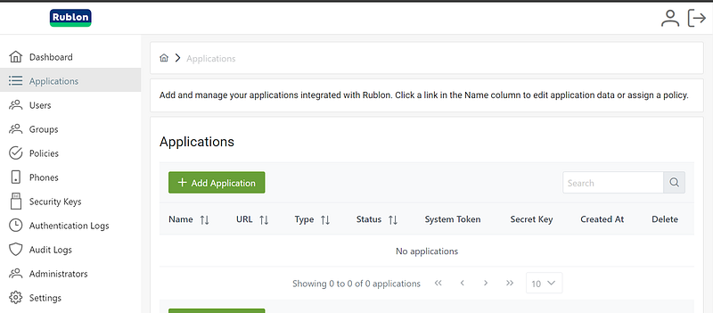

4. Enter a name for your application (e.g., Linux SSH) and set the type to **Linux SSH**.

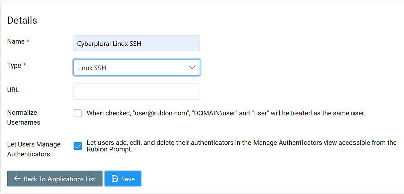

5. Click **Save** to add the application.

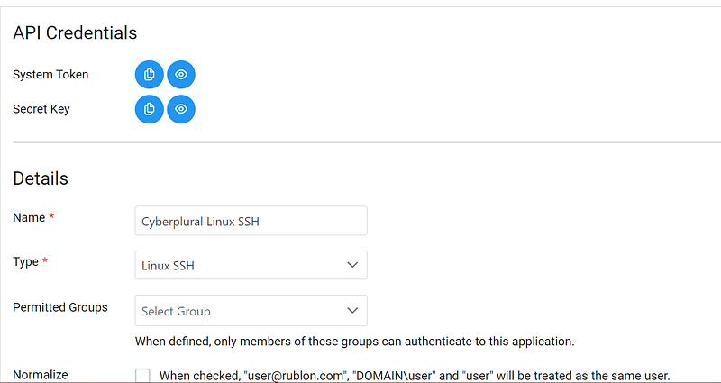

6. Copy and save the **System Token** and **Secret Key** values, as you will need them later.

### Step 2: Install the Rublon Authenticator

All end-users must install the Rublon Authenticator mobile app. It’s recommended that administrators also install the app.

- Download the Rublon Authenticator for:
- [Android](https://play.google.com)
- [iOS](https://apps.apple.com)

After installing the app, users can authenticate using:

- [**Mobile Push**](https://rublon.com/product/mobile-push/)
- [**Mobile Passcode**](https://rublon.com/product/mobile-passcode/)

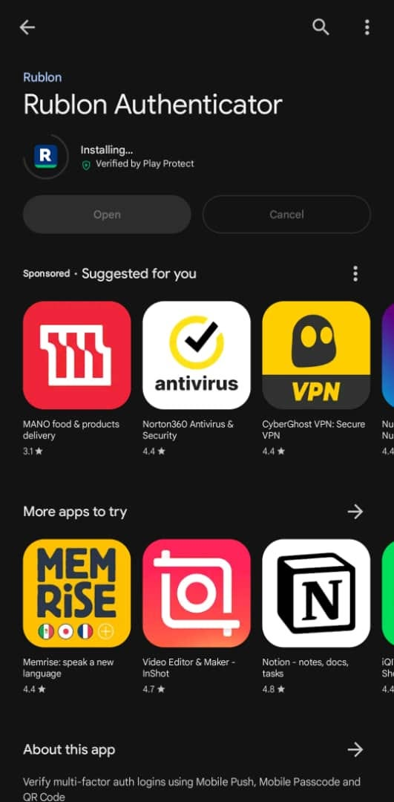

### Step 3: Installing Rublon MFA for Linux SSH

1. Download the appropriate Rublon package for your Linux distribution.
2. Install the package:

**Ubuntu & Debian**:

```
sudo dpkg -i <package_name>
```

**RHEL & CentOS**:

```
sudo yum install <package_name>
```

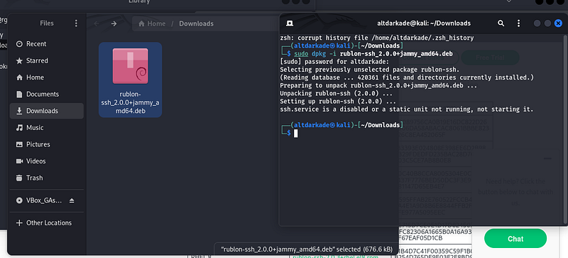

After installation, the SSH service may be disabled. To enable and start it:

```
sudo systemctl 
enable
 ssh
sudo systemctl start ssh
sudo systemctl status ssh
```

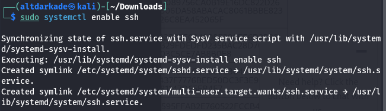

3. Edit the `rublon.config` file:

```
sudo nano /etc/rublon.config
```

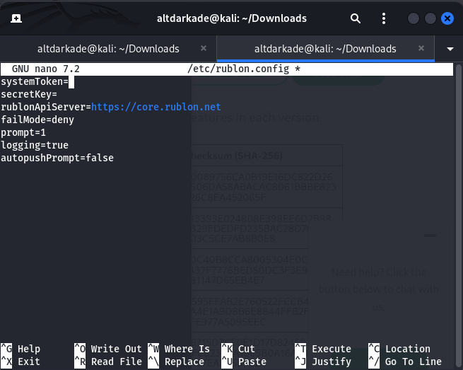

- Paste the **System Token** and **Secret Key** values.
- Adjust other options as necessary, or leave the default values.

### Modifying the SUDO Service Configuration

To configure the Rublon PAM module for the sudo service:

1. Open the `/etc/pam.d/sudo` file.
2. Replace:

```
@include common-auth
```

with:

```
#
@include
 common
-
auth
auth 
required
 pam_env.so
auth requisite pam_unix.so
auth sufficient pam_rublon.so
auth 
required
 pam_deny.so
```

### Modifying the SU Service Configuration

To configure the Rublon PAM module for the su service:

1. Open the `/etc/pam.d/su` file.
2. Replace:

```
@include common-auth
```

with:

```
#
@include
 common
-
auth
auth 
required
 pam_env.so
auth requisite pam_unix.so
auth sufficient pam_rublon.so
auth 
required
 pam_deny.so
```

### Step 4: Enable Rublon MFA for SSH Key Authentication

To enforce SSH key authentication with Rublon MFA:

### SSH Configuration

1. Edit the `/etc/ssh/sshd_config` file to increase the session login timeout to 15 minutes.

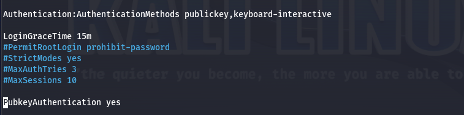

### Public Key Authentication

1. Edit the `01-rublon-ssh.conf` file (located in `/etc/ssh/sshd_config.d/` for Debian, Ubuntu, and RHEL 9):

```
AuthenticationMethods publickey,keyboard-interactive
```

2. Set the following:

```
MaxAuthTries
 
3
PubkeyAuthentication
 
yes
PasswordAuthentication
 
no
```

### PAM Configuration

1. In the `/etc/pam.d/sshd` file, add:

```
auth requisite pam_rublon.so
account 
required
 pam_rublon.so
```

2. For Ubuntu/Debian, replace:

```
@include common-auth
```

with:

```
#@include common-auth
```

3. Finally, verify that the service is active:

```
systemctl status sshd
```

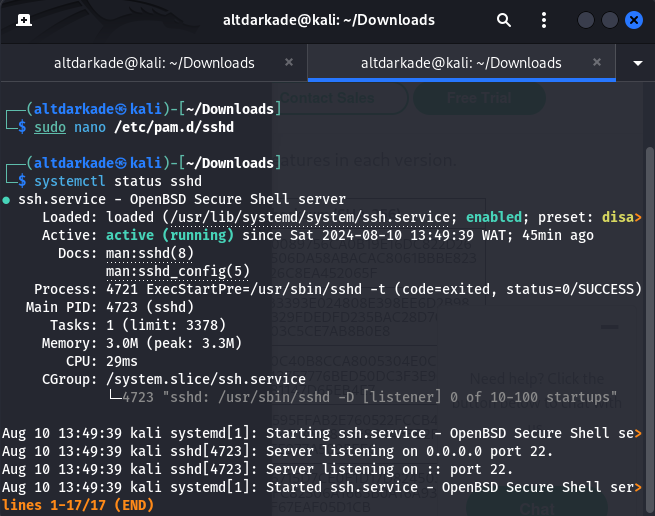

### Step 5: Testing Rublon Authentication

To test Rublon authentication:

1. Access the SSH service.

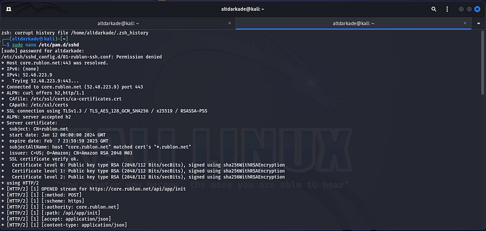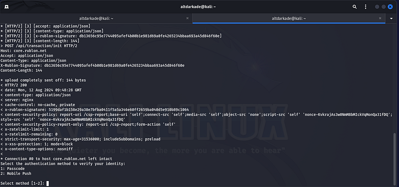

2. Choose an authentication method and confirm it using the Rublon Authenticator app.

3. A mobile push notification should appear on the authenticator app for confirmation.

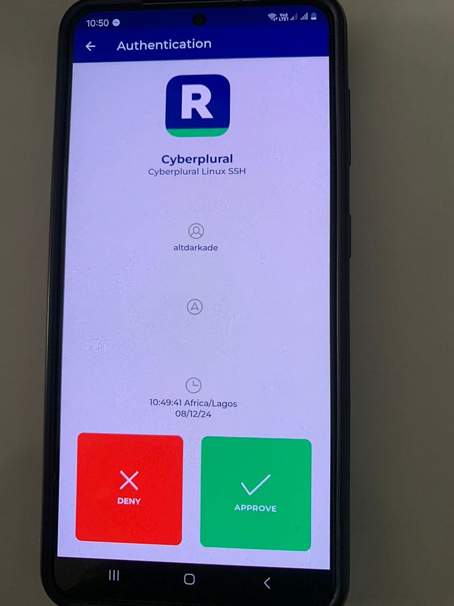

### Step 6: View Authentication Logs in the Admin Console

Logs from the Linux SSH service can now be viewed in the **Rublon Admin Console**, providing insights into authentication activities.

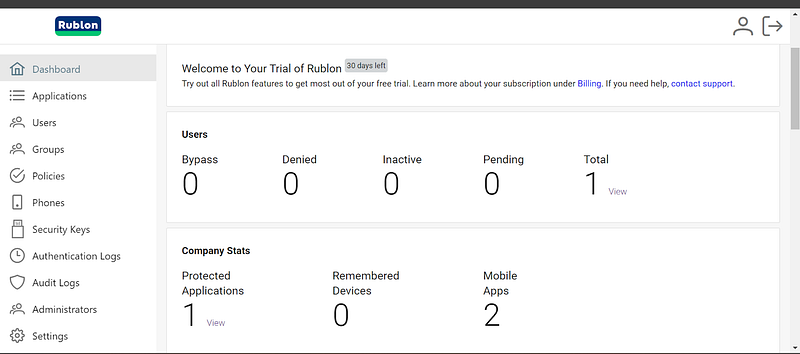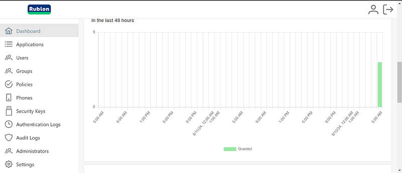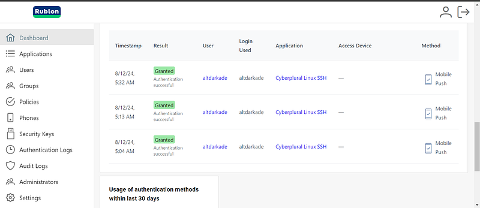

By following the steps outlined in this guide, you can significantly enhance the security of your Linux servers by implementing Rublon MFA for SSH. Multi-factor authentication ensures that even if a user’s password is compromised, unauthorized access is prevented by requiring a second factor of authentication. With Rublon’s seamless integration and a wide range of authentication methods, you can protect sensitive data and maintain the integrity of your systems. Whether you’re using password-based or key-based authentication, Rublon provides an extra layer of security that is both user-friendly and robust.

#CyberSecurity #MFA #LinuxSecurity #RublonMFA #SSH #TwoFactorAuthentication #Linux #ServerSecurity #ITSecurity #Authentication #SysAdmin #LinuxAdmin #SecurityBestPractices
